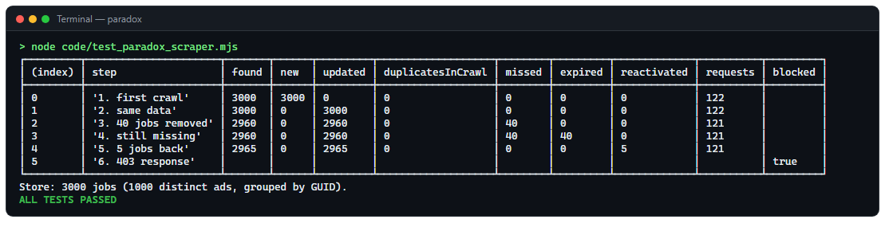
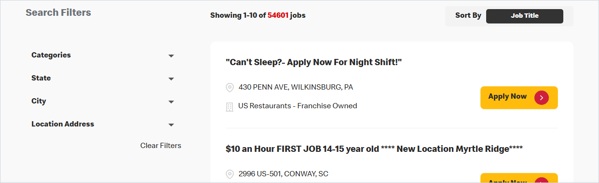
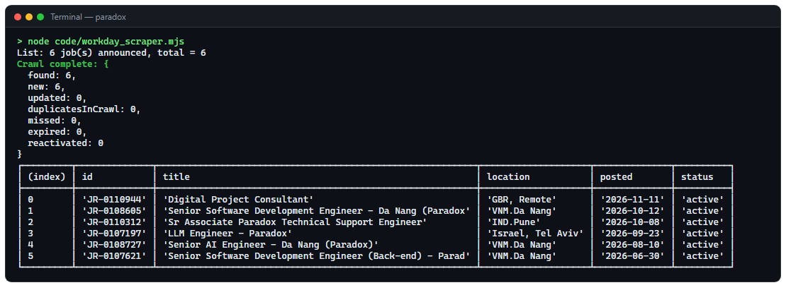
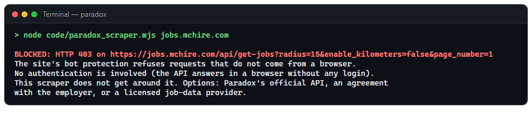

# Exercice scraping : les offres d'emploi Paradox

11 novembre 2026

## Synthèse

Toutes les offres hébergées par Paradox passent par **une seule API AJAX, la même pour tous les clients** : un seul scraper suffit donc pour l'ensemble de la plateforme. J'ai vérifié 6 sites carrières (environ 72 700 offres) et 15 entreprises qui publient leurs offres via Paradox.

La consigne : *« scrape all the jobs from paradox.ai. How would you do it? Give me a list of all the jobs you found. How would you check that those jobs expire? How would you ensure you're not scraping the same jobs twice? »*

| Question | Réponse courte |
| --- | --- |
| Comment faire ? | Appeler directement l'API `POST /api/get-jobs` utilisée par les sites carrières Paradox, au lieu de parser le HTML. Contourner le plafond de 10 000 résultats en découpant par État. |
| Les offres trouvées | 6 sites confirmés, environ 72 700 offres (McDonald's, FedEx, Sodexo, Regis), plus les 6 offres internes de Paradox sur Workday (au 11/11/2026). |
| Vérifier l'expiration | L'API ne donne aucune date : une offre est expirée quand elle disparaît de deux crawls complets d'affilée. |
| Éviter les doublons | Clé unique `uniqueID`, upsert en base avec `first_seen` / `last_seen`. |

Point important : depuis un script, l'API des sites clients répond **403** (protection anti-bot). J'en tiens compte dans l'approche que je propose pour la production.

## Où sont les offres ?

`paradox.ai/careers` renvoie une 404, et `careers.paradox.ai` redirige vers le site carrières de **Workday**, qui a racheté Paradox (accord signé en août 2025, rachat finalisé le 1er octobre 2025). La consigne peut donc se lire de deux façons :

1. **Les offres de l'entreprise Paradox** : elles sont sur le portail Workday. Une recherche « paradox » via l'API Workday (`POST /wday/cxs/workday/Workday/jobs`) en renvoyait 5 le 10/11/2026 et 6 le 11/11/2026.
2. **Les offres que Paradox héberge pour ses clients** : Paradox est un ATS conversationnel (assistant « Olivia ») utilisé par de grands recruteurs, comme McDonald's ou FedEx. Ce sont des dizaines de milliers d'offres.

J'ai retenu la **lecture 2**, plus proche d'un besoin d'agrégateur, et je traite la lecture 1 en annexe des résultats.

## Comment je scrape un site Paradox

On appelle directement l'API JSON que la page utilise en AJAX, et on contourne son plafond de 10 000 résultats en découpant la recherche par État.

1. **Repérer la requête AJAX.** La 1re page de résultats est générée côté serveur (10 offres seulement dans le HTML). Les pages suivantes sont chargées par cette requête, visible dans l'onglet Network des DevTools :

```
POST https://<site-client>/api/get-jobs?page_number=2&radius=15&enable_kilometers=false
Content-Type: application/json
{"disable_switch_search_mode": false, "site_available_languages": ["en", "en-us"]}
```

2. **Lire la réponse.** Elle contient `jobs` (les offres), `totalJob` (le total) et `facets` (les filtres disponibles avec leur nombre d'offres : catégorie, État, ville…).
3. **Paginer.** On incrémente `page_number`. La taille de page change selon le client (10 chez McDonald's, 25 chez FedEx), donc on la lit dans la réponse au lieu de la coder en dur.
4. **Contourner le plafond.** Sur McHire (54 602 offres), la page 1000 répond, mais à partir de la page 1001 on obtient 0 offre et `totalJob: 0`. On ne peut donc atteindre que 10 000 offres par recherche.
5. **Découper.** On lit la facette `state` dans la 1re réponse, puis on pagine État par État avec `&filter[state]=Texas` dans l'URL (5 013 offres, toutes au Texas). Le plus gros État reste sous 10 000 ; sinon, on redécoupe par `city` ou `category`.
6. **Rester correct avec le serveur.** Un délai entre les requêtes (McHire seul représente plus de 5 000 pages), des retries en cas d'erreur et un User-Agent identifiable.

La même API et le même format de données se retrouvent sur tous les sites testés (McHire, FedEx, Sodexo, Regis) : un scraper écrit une fois sert pour tous les clients.

Comme l'API réelle bloque les scripts, la logique du scraper est **testée sur une copie locale de l'API** qui reproduit son comportement (plafond, filtres, facettes, même annonce sur plusieurs lieux). Sur 3 000 offres fictives, le scraper les récupère toutes malgré le plafond, en 122 requêtes, et les tests de doublons, d'expiration et de blocage passent tous.


*Les 6 étapes du test : 1er crawl malgré le plafond, aucun doublon, 40 offres manquées une fois puis expirées, 5 réactivées, arrêt propre sur un 403.*

## Les offres trouvées

Les 6 sites carrières Paradox vérifiés totalisent environ **72 700 offres** (relevés des 10 et 11 novembre 2026, valeur `totalJob` de l'API).


*La page de recherche de McHire le 11/11/2026 : 54 601 offres annoncées (54 602 la veille). Seules les 10 premières sont dans le HTML.*

| Client | Site carrières | Offres | Format des identifiants |
| --- | --- | --- | --- |
| McDonald's | `jobs.mchire.com` | 54 602 | `PDX_MC_…` |
| Regis | `careers.regiscorp.com` | 5 378 | hash de 32 caractères |
| FedEx | `careers.fedex.com` | 4 681 | `PDX_FEC_…` |
| Sodexo | `jobs.us.sodexo.com` | 3 898 | `PDX_SO_…` |
| Regis (Supercuts) | `jobs.supercuts.com` | 2 652 | hash de 32 caractères |
| Regis (SmartStyle) | `jobs.smartstyle.com` | 1 521 | hash de 32 caractères |

Chaque offre contient le titre, la description HTML, l'adresse complète avec coordonnées GPS, l'employeur (souvent un franchisé) et l'URL de candidature. La liste complète des offres n'est pas extraite : depuis un script, l'API répond 403 (voir *Limites*).

**Annexe : les offres internes de Paradox** (portail Workday, recherche « paradox », récupérées par `code/workday_scraper.mjs` le 11/11/2026)


*Le scraper Workday trouve les 6 offres et les enregistre comme nouvelles. Une 2e exécution les met à jour sans créer de doublon.*

| Poste | Lieu | Référence | Publiée le |
| --- | --- | --- | --- |
| Digital Project Consultant | Royaume-Uni, télétravail | JR-0110944 | 11/11/2026 |
| Senior Software Development Engineer - Da Nang (Paradox) | Da Nang, Vietnam | JR-0108605 | 12/10/2026 |
| Sr Associate Paradox Technical Support Engineer | Pune, Inde | JR-0110312 | 08/10/2026 |
| LLM Engineer - Paradox | Tel Aviv, Israël | JR-0107197 | 23/09/2026 |
| Senior AI Engineer - Da Nang (Paradox) | Da Nang, Vietnam | JR-0108727 | 10/08/2026 |
| Senior Software Development Engineer (Back-end) - Paradox - Da Nang | Da Nang, Vietnam | JR-0107621 | 30/06/2026 |

La recherche porte sur tout le texte de l'offre : « Digital Project Consultant » mentionne Paradox sans forcément faire partie de son équipe. C'est la limite d'un filtre par mot-clé.

## Vérifier qu'une offre a expiré

L'API Paradox ne donne **aucune date**, ni de publication ni d'expiration : l'expiration se déduit donc en comparant les crawls successifs.

- **Recrawler chaque client régulièrement**, par exemple une fois par jour.
- **Marquer `expired`** une offre absente de **deux crawls complets d'affilée**. Un seul passage manqué peut venir d'une erreur réseau ou d'une page sautée.
- **Ne conclure que sur un crawl sain** : il s'est terminé sans erreur, et son `totalJob` est cohérent avec le précédent. Sinon, une panne ferait « expirer » des milliers d'offres d'un coup.
- **Confirmer si possible sur la page de l'offre.** Côté Workday, j'ai vérifié qu'une offre disparue renvoie HTTP 404, et `canApply: false` signale une offre fermée.

## Ne pas scraper deux fois la même offre

La clé unique est le champ **`uniqueID`**, enregistré en base par un upsert qui met à jour `first_seen` et `last_seen`.

- **`uniqueID`** a la forme `PDX_<client>_<GUID>_<locationID>` (ex. `PDX_MC_88A0AF9A-…_83039`). Son format change selon le client : chez Regis, c'est un hash de 32 caractères.
- **Une même annonce est publiée une fois par lieu** : même GUID, `locationID` différent. Un agrégateur peut garder une entrée par lieu, ou regrouper par GUID pour éviter des centaines d'annonces identiques.
- **Upsert** sur `uniqueID` : une offre inconnue est insérée avec `first_seen`, une offre déjà connue voit seulement son `last_seen` mis à jour. Le découpage par État ne crée pas de doublons, mais l'upsert protège si des filtres se chevauchent.
- **Optionnel** : stocker un hash de la description pour détecter les offres modifiées.

Avec `first_seen`, `last_seen` et un statut `active` / `expired`, la même table répond aussi à la question de l'expiration.

## Trouver tous les clients de Paradox

Il n'existe pas de liste officielle : on recoupe des sources publiques, puis on valide chaque entreprise. J'en ai confirmé **15 qui publient leurs offres via Paradox**, sur 29 étudiées.

**Les sources**

1. **Certificate Transparency** (`crt.sh`) : chaque certificat HTTPS est publié dans un registre public. Pour `*.paradox.ai`, j'ai trouvé 4 205 certificats et 284 sous-domaines. Leurs noms révèlent les clients qui ont une instance dédiée (`fedexapi`, `lowesapi`, `api-k8s.sodexo`…).
2. **Le DNS** : les sites carrières Paradox pointent en CNAME vers `<client>.sites.paradox.ai` (ex. `careers.fedex.com` → `fedex.sites.paradox.ai`). Exception : McHire n'a pas de CNAME (enregistrement A), donc cette méthode seule le manque. Ce sous-domaine utilise un DNS wildcard, donc on ne peut pas deviner les clients : il faut une base de DNS passif pour faire la recherche inverse.
3. **Les pages de candidature `/co/`** : chaque offre a une page publique `<tenant>.paradox.ai/co/<Compte>/Job?job_id=…`. La plateforme commune `olivia.paradox.ai` regroupe la plupart des clients, avec un compte par entreprise ou par franchisé (ex. `Wendys89619`). Ces pages sont indexées par les moteurs de recherche (`site:olivia.paradox.ai`).
4. **Les sources commerciales** : Fantastic.jobs publie les employeurs les plus actifs sur Paradox.

**La validation** : une mention de Paradox ne suffit pas. Lowe's, par exemple, a une instance Paradox et un champ `paradoxJobId` dans ses données, mais ses offres sont publiées par Phenom et gérées dans Workday. Le critère fiable : un CNAME vers `sites.paradox.ai` ou des pages `/co/`, et une réponse de `/api/get-jobs` au format Paradox (`jobs`, `totalJob`, `facets`). Le préfixe `PDX_` n'est pas suffisant, puisque Regis n'en a pas.

| Résultat | Entreprises |
| --- | --- |
| Site carrières Paradox | McDonald's, FedEx, Sodexo, Regis (3 sites) |
| Offres sur des pages `/co/` d'une instance dédiée | Darden (Olive Garden, LongHorn, Capital Grille, Bahama Breeze), Advantage Solutions |
| Offres sur la plateforme commune `olivia.paradox.ai` | Hardee's, Valvoline, Five Guys, Raising Cane's, Wendy's, Moe's, White Lodging, Taco John's, Comfort Keepers |
| Client Paradox, offres publiées ailleurs | Lowe's (Phenom), PepsiCo (Jibe), Unilever (TalentBrew), Lockheed Martin et Prudential (sites propres) |
| À vérifier | Aramark, Visiting Angels, ISS, Cargill, Americold |

Le total réel se compte probablement en milliers de comptes : chez les franchisés, les numéros de compte sont élevés (`Wendys89619`, `McDonalds4680`). Pour obtenir un chiffre, je lance une recherche dans Common Crawl sur toutes les URL `*.paradox.ai/co/*`. Le script est prêt, mais l'index était indisponible (erreurs 504) le 11 novembre 2026.

## Limites et approche en production

L'API des sites clients est protégée : elle répond normalement dans un navigateur, mais **renvoie 403 « Access Denied » à un script** (Node, Deno ou Python, et Colab ne changerait rien). La page HTML se charge, mais ne contient que les 10 premières offres. L'API Workday, elle, répond normalement aux scripts.


*Sur le vrai site, la 1re requête reçoit un 403 : le scraper s'arrête et explique pourquoi, sans tenter de contourner la protection.*

Cette protection montre que l'éditeur ne veut pas d'accès automatisé à cette API. Un navigateur piloté (Playwright, Puppeteer) passerait peut-être, mais ce serait contourner une protection volontaire : c'est contraire aux conditions d'utilisation et fragile dans le temps. Je ne l'ai pas fait.

En production, je passerais par l'une de ces options :

- **L'API officielle de Paradox**, via un partenariat ou un accord avec chaque client.
- **Un fournisseur de données sous licence**, comme [Fantastic.jobs](https://fantastic.jobs/ats/paradox) ou [Apify](https://apify.com/fantastic-jobs/paradox-ai-jobs-api), qui vendent déjà exactement ces données. C'est la preuve que le besoin existe.
- **Les flux que les clients publient eux-mêmes** (données structurées `JobPosting`, flux envoyés à Indeed ou Google for Jobs).

## Prochaines étapes

Le code et les résultats sont dans le dossier du projet (voir son `README.md`). Il reste à obtenir le nombre exact de clients et à valider 5 entreprises.

| Dossier | Contenu |
| --- | --- |
| `code/` | `workday_scraper.mjs` (fonctionne réellement), `paradox_scraper.mjs` (scraper générique Paradox), `test_paradox_scraper.mjs` (tests sur la copie locale de l'API), `find_paradox_clients.mjs` (crt.sh + DNS), `cc_paradox_accounts.mjs` (Common Crawl), `lib/store.mjs` (doublons et expiration) |
| `results/` | offres Workday (CSV, JSON), `paradox_clients.csv` (29 entreprises), tenants crt.sh, classement DNS des sites carrières, journaux d'exécution (dont le 403 réel sur McHire et les tests) |
| `data/` | résultat brut de crt.sh (4 205 certificats) |
| `rapport/` | ce document en PDF et en Markdown |

- [ ] Relancer la recherche Common Crawl dès que l'index répond, et compter les comptes `/co/` uniques.
- [ ] Valider les 5 entreprises « à vérifier » (Aramark, Visiting Angels, ISS, Cargill, Americold).

**Sources** : [Fantastic.jobs – Paradox Jobs API](https://fantastic.jobs/ats/paradox) · [Apify – Paradox.ai Jobs API](https://apify.com/fantastic-jobs/paradox-ai-jobs-api) · [crt.sh](https://crt.sh/?q=%25.paradox.ai) · [Common Crawl](https://index.commoncrawl.org/) · [ADP Marketplace – Paradox Conversational ATS](https://apps.adp.com/en-US/apps/417358/Paradox%20Conversational%20ATS/features)
